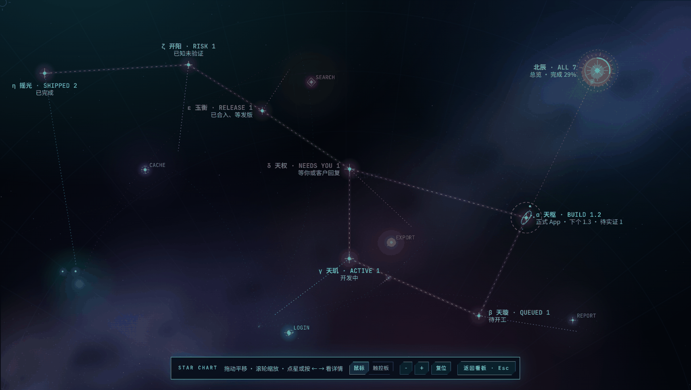
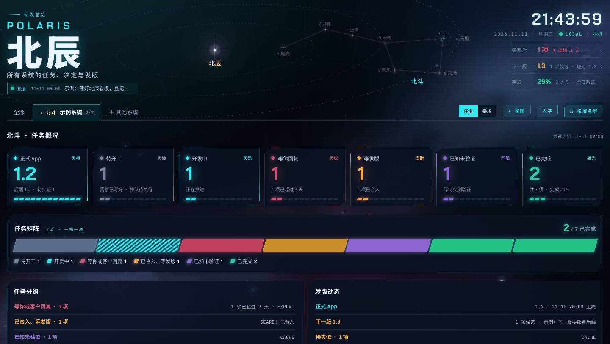

# Polaris · 北辰

[中文](README.md)

Polaris is a Claude Code plugin that records requirements and task progress locally, displays multiple systems on a constellation dashboard, and exports shareable read-only snapshots.





## Requirements

- Node.js **22.13 or newer**, with built-in `node:sqlite` enabled; use an official [Node.js LTS build](https://nodejs.org).
- Claude Code for plugin installation and Skills.
- Optional git for backup commits. Without git, SQL is still exported to `backup/polaris.sql`, without a commit.

Plugin users do not need pnpm or project dependencies.

## Install

Replace `<repository-url>` with this repository's Git address. You need read access to it, and your local git must be able to fetch it (HTTPS credentials or an SSH key).

```bash
claude plugin marketplace add <repository-url>
claude plugin install polaris@polaris
```

Or install from the local repository root:

```bash
claude plugin marketplace add /path/to/polaris
claude plugin install polaris@polaris
```

Start a new Claude Code session afterward. For a temporary local trial, run `claude --plugin-dir ./plugin`.

## First use

In a new session, ask Claude to “记一条需求” (record a requirement), or use `/polaris:status`. Claude asks for the system name, description, constellation (default: 北斗), and key, then creates a local database. CLI messages and session summaries are currently in Chinese.

The default directory is `~/Documents/polaris-data/`, also under the user's home directory on Windows. It contains `polaris.db` (with runtime WAL/SHM files), `backup/polaris.sql`, and the default snapshot `build/mirror.html`. Each user has independent data.

Set `POLARIS_HOME` before launching Claude Code, or pass `--home DIR` to the CLI:

```bash
# macOS / Linux
export POLARIS_HOME="$HOME/polaris-data"
```

```powershell
# Windows PowerShell
$env:POLARIS_HOME = Join-Path $HOME 'polaris-data'
```

Use a writable local directory outside cloud-sync folders. Changing the setting does not move existing data.

## Slash commands

| Command | Purpose |
|---|---|
| `/polaris:status` | Decisions needed, next-release candidates, unverified work, completion |
| `/polaris:req` | Record a requirement, source, priority, and acceptance criteria |
| `/polaris:sync` | Record actual progress, decisions, and releases from the current conversation |
| `/polaris:mirror` | Export a read-only snapshot and help publish when tools are available |

Existing databases provide a read-only session summary of up to four lines. No database means no output. Set `POLARIS_HOOK=off` to disable it.

## Local dashboard

Ask Claude to open the dashboard, or use the installed plugin root as `<plugin-directory>` (it is `plugin` in a local checkout):

```bash
node "<plugin-directory>/bin/polaris.mjs" serve
```

Open http://127.0.0.1:8790/ . The server listens only locally. An existing Polaris instance is reported; if another application occupies the port, use `serve --port 8791`.

## Read-only mirror

```bash
node "<plugin-directory>/bin/polaris.mjs" mirror --out ./polaris-mirror.html
```

Publish the single HTML file as a Claude Artifact or on any static host, using your own publishing tools/account. It is a **snapshot and does not update automatically**. Regenerate and republish after changes.

## Data and privacy

Polaris stores its database and backups locally and does not upload them automatically. Content you send to Claude remains subject to Claude Code's data policies. Published mirrors contain requirements and tasks; anyone with the link may see them. Review the contents and hosting access settings before sharing.

## Update and uninstall

Maintainers increment the plugin manifest version and commit source plus built artifacts before releasing. Users run:

```bash
claude plugin marketplace update polaris
claude plugin update polaris@polaris
```

Start a new session. To uninstall:

```bash
claude plugin uninstall polaris@polaris
```

Uninstalling preserves the data directory. Back it up before manually deleting it.

## Troubleshooting

- Old Node: check `node --version`, install Node 22.13+, and check Claude Code's PATH.
- Missing `node:sqlite`: use an official Node LTS build and remove `--no-experimental-sqlite`, including from `NODE_OPTIONS`.
- Busy port: use `serve --port 8791` or inspect the existing Polaris server.
- Missing slash commands: install the whole plugin and start a new session after installation/update.
- Diagnose the environment with `doctor`, or use `--json` for structured results:

```bash
node "<plugin-directory>/bin/polaris.mjs" doctor
node "<plugin-directory>/bin/polaris.mjs" doctor --json
```

doctor checks Node, SQLite, the data directory, database existence/schema/integrity, git, the backup repository, and port 8790. It is read-only and exits 0 only when all checks pass, otherwise 1. Missing first-use data or optional git is reported as a failed check, but does not prevent initialization or SQL exports.

See [CONTRIBUTING.md](CONTRIBUTING.md) for development (Chinese). `history/index.v42.html` is the retained visual parity baseline.

License: pending author decision.
