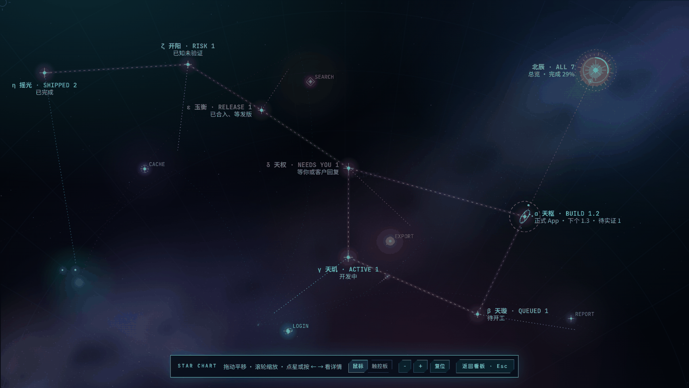

# 北辰 · Polaris

[English](README.en.md)

北辰是一个 Claude Code 插件：让 Claude 在工作时记录需求和任务进度，在本机星图看板查看多个系统，并导出可分享的只读镜像。




## 运行要求

- **Node.js 22.13 或以上**，且启用内置 `node:sqlite`；推荐从 [Node.js 官网](https://nodejs.org) 安装 LTS。
- **Claude Code**，用于安装插件和调用 Skill。
- **git（可选）**，用于自动备份的版本提交。没有 git 时仍会导出 `backup/polaris.sql`，但不提交。

安装用户无需安装 pnpm 或项目依赖。

## 安装

把 `<仓库地址>` 换成本仓库的 Git 地址。需要有这个仓库的读取权限，并且本机 git 能拉取它（HTTPS 账号或 SSH 密钥）。

```bash
claude plugin marketplace add <仓库地址>
claude plugin install polaris@polaris
```

从本地仓库目录安装（使用仓库根目录，marketplace 会定位到 `plugin/`）：

```bash
claude plugin marketplace add /path/to/polaris
claude plugin install polaris@polaris
```

安装后新开 Claude Code 会话。需要临时试用本地插件时，也可运行 `claude --plugin-dir ./plugin`。

## 第一次用

在新会话里说“记一条需求”，或输入 `/polaris:status`。Claude 会询问系统名称、说明、星座名（默认“北斗”）和系统 key，然后在本机建库。你自己的数据和其他安装者互不相干。

默认数据目录是 `~/Documents/polaris-data/`（Windows 为用户主目录下的 `Documents/polaris-data`）：

| 文件 | 用途 |
|---|---|
| `polaris.db` | SQLite 数据库，另有运行时 WAL/SHM 文件 |
| `backup/polaris.sql` | 每次成功写入后的 SQL 导出；有 git 时保留提交历史 |
| `build/mirror.html` | 默认镜像输出位置 |

可在启动 Claude Code 前设置环境变量 `POLARIS_HOME`，改到你有写权限的本机目录；CLI 也支持 `--home DIR`。例如：

```bash
# macOS / Linux
export POLARIS_HOME="$HOME/polaris-data"
```

```powershell
# Windows PowerShell
$env:POLARIS_HOME = Join-Path $HOME 'polaris-data'
```

不要把正在使用的数据库放到网盘同步目录。换目录不会自动搬迁旧数据。

## 斜杠命令

| 命令 | 用途 |
|---|---|
| `/polaris:status` | 看需要你、下一版候选、已知未验证和完成比例 |
| `/polaris:req` | 记录需求、来源、优先级和验收标准 |
| `/polaris:sync` | 把当前对话中已发生的任务进展、决定和发版同步到北辰 |
| `/polaris:mirror` | 生成只读镜像，在发布工具可用时协助发布 |

有数据库时，会话开始会注入最多 4 行只读摘要；无库时不输出。设置 `POLARIS_HOOK=off` 可关闭。

## 本机看板

让 Claude “打开北辰本机看板”，或运行下面的 CLI 命令。本文的 `<插件目录>` 指已安装的插件根目录；本地仓库里就是 `plugin`，Claude 的 Skill 会自动使用正确路径。

```bash
node "<插件目录>/bin/polaris.mjs" serve
```

打开 http://127.0.0.1:8790/ 。服务只监听本机。若该端口已有北辰，会提示已经运行；若被其他程序占用，改用：

```bash
node "<插件目录>/bin/polaris.mjs" serve --port 8791
```

## 只读镜像

```bash
node "<插件目录>/bin/polaris.mjs" mirror --out ./polaris-mirror.html
```

生成一个内嵌数据的 HTML 文件，可发布为 Claude Artifact，或放到任何静态托管平台。发布需要相应工具或托管账号。镜像是生成时的**快照，不会自动更新**；数据变化后需要重新生成并发布。

## 数据与隐私

北辰的数据只保存在本机，不自动上传数据库或备份。你发给 Claude 的需求和对话仍按 Claude Code 的数据政策处理。镜像包含需求与任务内容；发布后，拿到链接的人可能都能看到，分享前请检查内容及托管平台的访问设置。

## 更新与卸载

管理者发布新版本时，应先递增 `plugin/.claude-plugin/plugin.json` 的 `version`，并提交源码和构建产物。用户更新：

```bash
claude plugin marketplace update polaris
claude plugin update polaris@polaris
```

更新后新开会话。卸载：

```bash
claude plugin uninstall polaris@polaris
```

卸载插件不会删除数据目录；如需清理，请先备份再自行删除。

## 常见问题

- **Node 版本太低**：运行 `node --version`，安装 Node 22.13 或以上，并确认 Claude Code 使用同一套 PATH。
- **`node:sqlite` 不可用**：使用 Node 官方构建，升级 LTS，并检查 `NODE_OPTIONS` 或启动参数中是否有 `--no-experimental-sqlite`。
- **端口被占用**：用 `serve --port 8791`，或先确认已有北辰服务是否可用。
- **斜杠命令不出现**：确认安装的是完整插件，安装或更新后新开会话。
- **检查环境与数据**：运行以下命令。doctor 只读检查 Node、SQLite、数据目录、数据库迁移版本和完整性、git、备份仓库及 8790 端口。每项显示 ✓ / ✗ 与修复建议；全部通过退出 0，否则退出 1。首次尚未建库或未装可选 git 也会标记未通过，但不妨碍首次建库或 SQL 导出。

```bash
node "<插件目录>/bin/polaris.mjs" doctor
node "<插件目录>/bin/polaris.mjs" doctor --json
```

开发与贡献见 [CONTRIBUTING.md](CONTRIBUTING.md)。历史页面仅保留 `history/index.v42.html`，作为新旧对照测试基准。

许可证：待定
